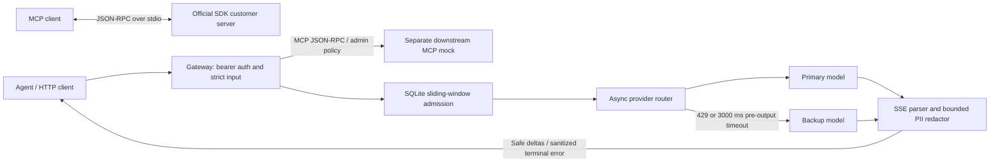

# Architecture and decisions

## ADR 1: preserve MCP protocol validation errors

Use the official Python MCP SDK for stdio transport and server lifecycle. Use strict Pydantic schemas as the single source of advertised schemas and runtime validation. The pinned 1.x SDK decorator catches arbitrary tool exceptions, including `McpError`, and converts them into tool error results. Registering a handler in its low-level server request dispatch table lets the SDK's own `McpError` handling produce JSON-RPC `-32602`. This dependency-sensitive choice is covered by real subprocess wire tests and an exact SDK version pin.

## ADR 2: opaque bearer credentials

Authentication resolves an opaque secret to a server-owned tenant and role. This meets the assessment without insecurely decoding unverified JWT claims or requiring an identity provider for the demo. Constant-time comparisons protect credential equality checks; settings representations hide secrets. Production should use managed identity/token introspection or validated JWTs with pinned algorithms, issuer, audience, expiry, and key rotation. The role policy is applied before any network operation, including notification requests.

## ADR 3: complete lexical candidates before release

A fixed lookbehind alone cannot safely handle arbitrarily long email-like strings. Holding the current token until a delimiter avoids releasing a valid email prefix before its suffix arrives. Numbers may span spaces/hyphens; numeric candidates are retained across those separators. Candidate state is capped at 320 characters, with fail-closed suppression for oversized tokens. Text is redacted before it reaches the public SSE encoder, so no unsafe provider event is forwarded verbatim.

State uses O(320) candidate memory plus the current bounded provider event/chunk. It processes one character at a time; numeric classification scans at most 320 characters, a fixed bound. The output produced by `feed` is proportional to the input delta, not the full generation. The nonstream API intentionally assembles a final answer, bounded by output and request-duration caps.

SSE framing and PII boundaries are separate problems: `sse_data` reconstructs provider events from arbitrary bytes; `StreamRedactor` reconstructs candidates from text deltas. Tests vary both boundaries independently. SSE events larger than 64 KiB, malformed JSON, unexpected delta structures, or streams missing `[DONE]` fail closed.

## ADR 4: reserve the token budget before generation

Tenant identity comes from authentication. The estimator charges UTF-8 prompt bytes plus an envelope allowance and the requested output cap. For typical byte-level tokenizers this overestimates prompt usage; it is explicitly not a precise tokenizer for every arbitrary provider. Reserving the output cap prevents concurrent requests from each observing unspent capacity. Charges are retained for the rolling window even on errors or cancellation; no incomplete stream can refund work already sent upstream.

SQLite stores `(hashed_tenant, admission_time, reserved_tokens)` rows. Each admission begins an immediate write transaction, samples the clock after obtaining the lock, deletes expired rows, sums the tenant's active reservations, and inserts only if the budget fits. Interval semantics are `(now - 60, now]`: a row expires exactly at 60 seconds. A denied request still commits expiry cleanup. The database connection closes after every operation. Blocking SQLite work executes in `asyncio.to_thread`, leaving the event loop free for streams.

Separate processes on the same machine use SQLite's transaction lock. Independent replicas with independent files do not share a budget; SQLite on network filesystems is outside this design. A distributed deployment needs a shared transactional store. Reservations use wall-clock timestamps to survive restarts; hosts must maintain synchronized clocks. Backward clock jumps make admission conservative; forward jumps can expire rows early.

## ADR 5: fail over before output only

`asyncio.timeout(3)` bounds each attempt to fetch the next text delta. The initial deadline includes connect, headers, and empty/heartbeat events before the first text. On primary 429 or timeout, close its iterator and invoke backup once. No detached upstream task is left racing a backup call. Nonretryable status codes fail immediately. Once a provider yields text, a subsequent failure terminates the response instead of mixing independent generations. Both nonstream and streaming APIs use this same rule.

The 30-second total deadline also includes backup work. Streams close through nested async context managers on completion, failure, explicit close, or cancellation. There is no automatic user-level replay. A provider that ignores `max_tokens` is additionally limited by the gateway's byte and time caps.

## Protocol/error contract

| Condition | HTTP | Body |
| --- | --- | --- |
| Missing/invalid bearer | 401 | MCP `-32001` or standardized completion error |
| Malformed MCP JSON | 400 | JSON-RPC `-32700` |
| Invalid request envelope / unsupported batch | 400 | JSON-RPC `-32600` |
| Unknown HTTP MCP method | 200 | JSON-RPC `-32601` |
| Invalid tool-call params | 200 | JSON-RPC `-32602` |
| Viewer calls `admin_*` | 200 | JSON-RPC `-32001`, request ID preserved |
| Downstream MCP fails | 502 | JSON-RPC `-32603`, no raw upstream diagnostics |
| Completion validation fails | 400 | `error.code=invalid_request` |
| Tenant admission denied | 429 | `error.code=rate_limited`, `Retry-After` |
| Limiter unavailable | 503 | `error.code=gateway_unavailable` |
| Provider fails before nonstream response | 502 | `error.code=upstream_unavailable` |
| Provider fails after SSE response begins | 200 | SSE `event: error`; no `done` |

Notifications have no JSON-RPC response body, including denied calls. The proxy only forwards explicitly supported MCP methods. It does not attempt complete arbitrary MCP method/session support.

## Primary references

- [Official MCP Python SDK, pinned implementation](https://github.com/modelcontextprotocol/python-sdk/tree/v1.30.0): transport, low-level server, protocol error handling.
- [Starlette responses](https://www.starlette.dev/responses/): asynchronous streaming responses.
- [SQLite transactions](https://www.sqlite.org/lang_transaction.html): immediate write transaction semantics.
- [HTTPX async support](https://www.python-httpx.org/async/): streamed responses and connection cleanup.
